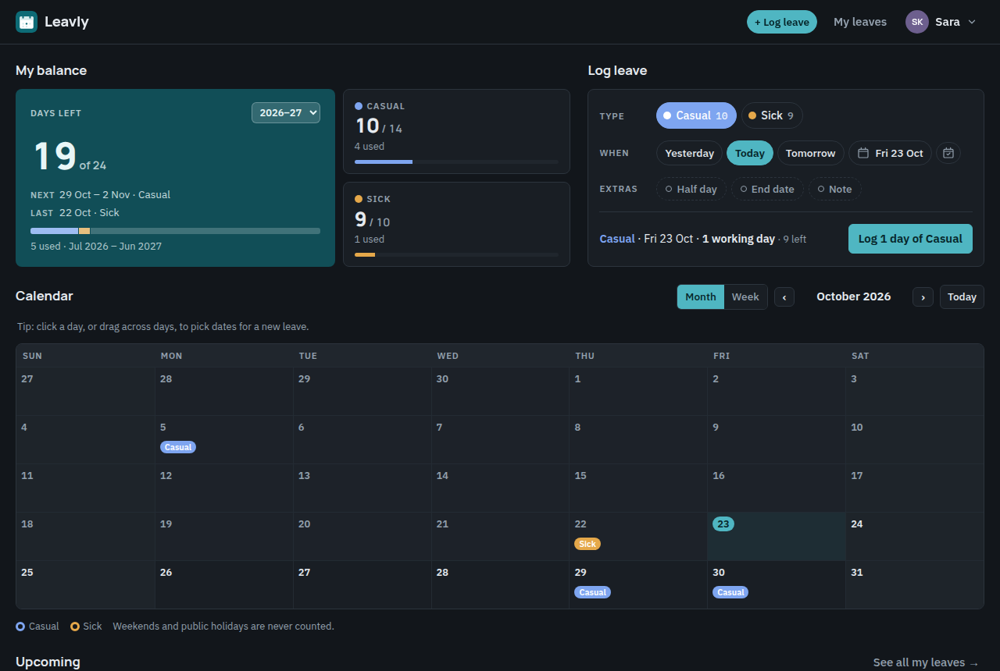
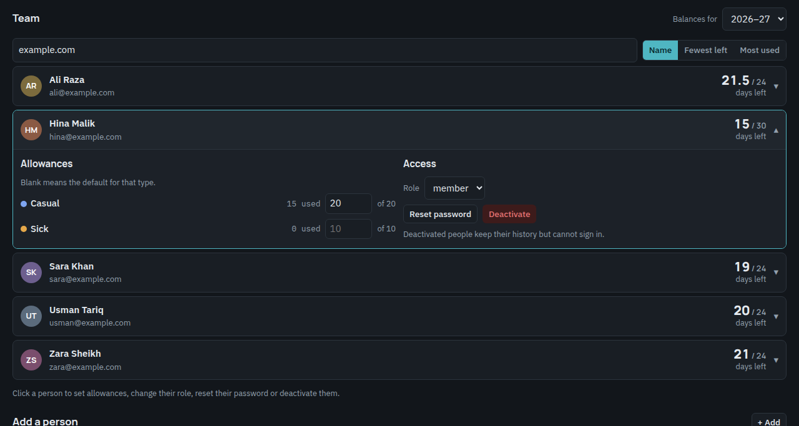
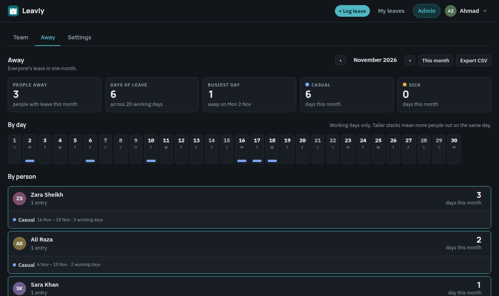

<h1 align="center">🗓️ Leavly</h1>

<p align="center">
  <b>Leave, kept simple.</b><br/>
  One place for a small team's days off. Log a day in two clicks, see your balance, never update a spreadsheet again.
</p>

<p align="center">
  
  
  
  
  
  <a href="LICENSE"></a>
</p>

<p align="center">
  <a href="#-quick-start">Quick start</a> ·
  <a href="#-how-it-counts">How it counts</a> ·
  <a href="#-features">Features</a> ·
  <a href="#-admin">Admin</a> ·
  <a href="#%EF%B8%8F-deployment">Deployment</a>
</p>

<p align="center">
  
</p>

---

## 🧭 What is Leavly?

An informal leave tracker for a group of colleagues who do not have an HR system. Everyone logs their own leave and it counts straight away, with no approval step. Balances count **working days only**: weekends and public holidays are never deducted. An admin adds people, sets the allowances and holidays, and gets a monthly report of who was away.

| ✍️ Log                                                                  | 📊 Balance                                                                             | 👥 Team                                                                      |
| ----------------------------------------------------------------------- | -------------------------------------------------------------------------------------- | ---------------------------------------------------------------------------- |
| Pick a type, a date or a range, optionally a half day, and you are done | Days left per type and in total for the leave year, with history and a running balance | Admins see the whole team on a calendar, a weekly strip and a monthly report |

## 🚀 Quick start

**Prerequisites:** Node 18+. Nothing else; local development uses an embedded Postgres in a folder.

```bash
git clone https://github.com/ahmad-zaman123/leavly.git
cd leavly
cp .env.example .env      # defaults to the embedded local database
npm install
npm run db:push           # creates the tables in ./pgdata
npm run dev               # http://localhost:3000
```

Open `/register`. The **first account becomes the admin**. After that nobody can self-register; the admin adds colleagues from the Admin page and gives each a starting password, which they must replace on first sign-in.

<details>
<summary><b>🔧 Environment variables</b> (<code>.env</code>)</summary>
<br/>

| Key                    | Required | Notes                                                                               |
| ---------------------- | -------- | ----------------------------------------------------------------------------------- |
| `DATABASE_URL`         | **yes**  | `pglite://./pgdata` locally (embedded, no server), or a Postgres URL in production. |
| `AUTH_SECRET`          | **prod** | Long random string used to sign sessions. `openssl rand -base64 32`.                |
| `GOOGLE_CLIENT_ID`     | no       | Turns on "Continue with Google" on the sign-in page. See **Google sign-in** below.  |
| `GOOGLE_CLIENT_SECRET` | no       | The matching client secret. Both must be set, or the button stays hidden.           |

</details>

<details>
<summary><b>📜 Scripts</b></summary>
<br/>

| Command                       | What it does                                                      |
| ----------------------------- | ----------------------------------------------------------------- |
| `npm run dev`                 | Development server with hot reload                                |
| `npm run build` / `npm start` | Production build and server                                       |
| `npm run db:push`             | Create or update the database tables from the schema              |
| `npm run format`              | Prettier over `src/`                                              |
| `npm run test:e2e`            | End-to-end suite in headless Chromium against a fresh local build |

</details>

## 🧮 How it counts

```
 leave year ──▶ starts in July (configurable) ──▶ 2026–27 = 1 Jul 2026 … 30 Jun 2027
                                                        │
 entry ──▶ every date from → to ──▶ skip weekends ──▶ skip public holidays ──▶ ½ if half day ──▶ days used
```

| Rule                      | Default                                                      |
| ------------------------- | ------------------------------------------------------------ |
| Leave types and allowance | Casual 14 · Sick 10 · **24 days a year**                     |
| Leave year                | July to June, set on the Settings page                       |
| Weekend                   | Saturday and Sunday, any days can be chosen                  |
| Public holidays           | Per date, or repeating every year                            |
| Half days                 | A single working day counted as 0.5                          |
| Over the balance          | Allowed, with a warning before saving                        |
| Overlaps                  | Blocked; one entry per person per day                        |
| Year boundary             | An entry across 30 June is split between the two leave years |

## ✨ Features

<table>
<tr>
<td width="50%" valign="top">

### ✍️ Log leave in seconds

Type chips, Yesterday / Today / Tomorrow, an inline date picker in the app's own format, or click and drag on the calendar. The summary and the button tell you exactly what will be saved, and overlaps or weekend-only dates are caught before you press it.

### 📅 Calendar

Month and week views with your leave as coloured pills, holidays named, today marked. Press <kbd>L</kbd> anywhere to jump to the form.

### 📊 Balance and history

Days left in total and per type, next and last leave at a glance, and a My leaves page with totals, a type filter, a running balance per row and CSV export.

</td>
<td width="50%" valign="top">

### ↩️ Undo, not confirm

Removing a leave is instant, with an Undo toast. Deactivating a person asks first.

### 🔒 Private by default

Members see only their own leave. Admins see everyone. Sessions are signed cookies, passwords are bcrypt hashed, and new people must choose their own password on first sign-in. Five wrong passwords lock an email for a minute.

### 🔑 Google sign-in

Optional "Continue with Google" for accounts an admin has already added. No self sign-up, and no starting password to replace.

### 🌗 Light, dark, phone

Light and dark themes, a bottom-sheet form and floating button on phones, and a web manifest so it installs to a home screen.

</td>
</tr>
</table>

## 🛡️ Admin

<p align="center">
  
</p>

| Tab          | What you can do                                                                                                                                                                                                                                              |
| ------------ | ------------------------------------------------------------------------------------------------------------------------------------------------------------------------------------------------------------------------------------------------------------ |
| **Team**     | Add people, search and sort, open a person to set per-type allowances, change their role, reset their password or deactivate them. A This week / This month strip shows who is off, and Upcoming leave lists everyone's future entries with remove and undo. |
| **Away**     | Any month at a glance: people away, days of leave, busiest day, a per-day strip and a per-person list. Export the month as CSV.                                                                                                                              |
| **Settings** | Leave types and their days, the month the leave year starts, weekend days, and public holidays, one-off or repeating every year. Changes save as you leave a field.                                                                                          |

<p align="center">
  
</p>

## 🔑 Google sign-in

Optional and free. It lets people sign in with the Google account whose email an admin added for them; it never creates accounts.

1. In [Google Cloud Console → Credentials](https://console.cloud.google.com/apis/credentials) create an **OAuth client ID** of type **Web application**. If asked, set up the consent screen first (External, app name, your email; no extra scopes).
2. Add the authorized redirect URI `https://<your-domain>/api/auth/google/callback`. JavaScript origins can stay empty.
3. Put the client ID and secret in `GOOGLE_CLIENT_ID` and `GOOGLE_CLIENT_SECRET` and redeploy. The button appears on the sign-in page.

## 🧪 Tests

An end-to-end suite drives the real app in headless Chromium: it adds people, takes them through first sign-in, logs leave of every shape (past, today, ranges over weekends and holidays, half days, across the leave-year boundary), checks balances, member isolation, every admin screen and setting, the login lock, phone layout and error pages. Dates are chosen relative to the day it runs.

```bash
npx playwright install chromium   # once
npm run test:e2e                  # builds, seeds an embedded test database, starts a server, runs, cleans up
```

To run it against a deployed instance, seed the QA accounts from `tests/db.js` into that database and run `BASE=https://your-site npm run test:e2e:live`. The same suite runs in GitHub Actions on every push.

## 🛠️ Tech stack

| Layer          | Tech                                                                                     |
| -------------- | ---------------------------------------------------------------------------------------- |
| **Framework**  | Next.js 15 (App Router, server actions), React 19                                        |
| **Database**   | Postgres with Drizzle ORM: Supabase in production, embedded PGlite for local development |
| **Auth**       | Signed-cookie sessions (jose), bcrypt password hashing                                   |
| **Styling**    | Hand-written CSS with light and dark theme tokens                                        |
| **Deployment** | Vercel + Supabase                                                                        |

## 🗂️ Project structure

```
leavly/
├── src/
│   ├── app/                    routes only (Next.js needs them here)
│   │   ├── page.tsx            dashboard
│   │   ├── leaves/ · account/  my leaves · change password
│   │   ├── admin/              team · away · settings
│   │   └── login · register · welcome
│   ├── frontend/
│   │   ├── components/         dashboard, forms, calendar, date picker, admin UI
│   │   ├── styles/globals.css  theme tokens, light and dark
│   │   └── lib/colors.ts       leave-type colours
│   ├── backend/
│   │   ├── db/                 Drizzle schema and database client
│   │   └── lib/
│   │       ├── actions.ts      all server actions
│   │       ├── auth.ts         sessions
│   │       ├── data.ts         queries and balances
│   │       └── dates.ts        working-day and leave-year maths
│   └── middleware.ts           route guard
└── public/                     icons and manifest
```

## ☁️ Deployment

The app needs a hosted Postgres. [Supabase](https://supabase.com) works well and has a free tier.

1. Create a Supabase project. In **Project settings → Database → Connection string** copy the **Transaction pooler** URL (port 6543). It looks like
   `postgresql://postgres.<ref>:<password>@aws-0-<region>.pooler.supabase.com:6543/postgres`.
   Use the pooler, not the direct host: the direct host is IPv6-only and unreachable from Vercel.
2. Create the tables in it from your machine:
   ```bash
   DATABASE_URL='postgresql://…pooler.supabase.com:6543/postgres' npm run db:push
   ```
3. Import the repository in [Vercel](https://vercel.com/new) with the Next.js preset and set `DATABASE_URL` and `AUTH_SECRET`.
   Set the function region to the one your Supabase project is in (for example `sin1` for ap-southeast-1) so every query is a short hop.
4. Deploy, open the site, create the first account at `/register`, and add everyone else from the Admin page.

## 📄 License

[MIT](LICENSE) © 2026 Ahmad Zaman
